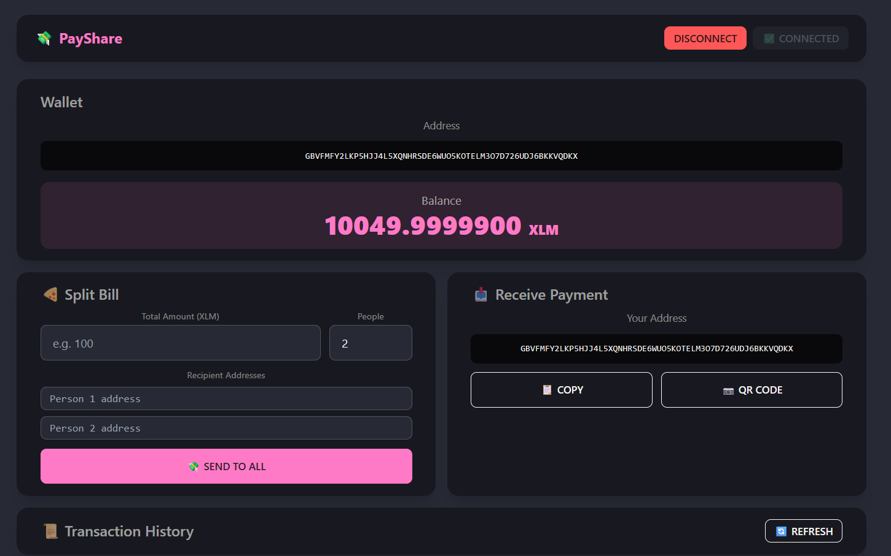
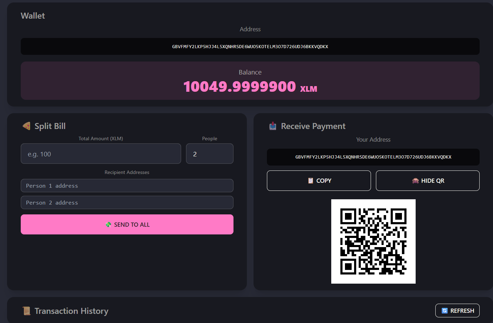
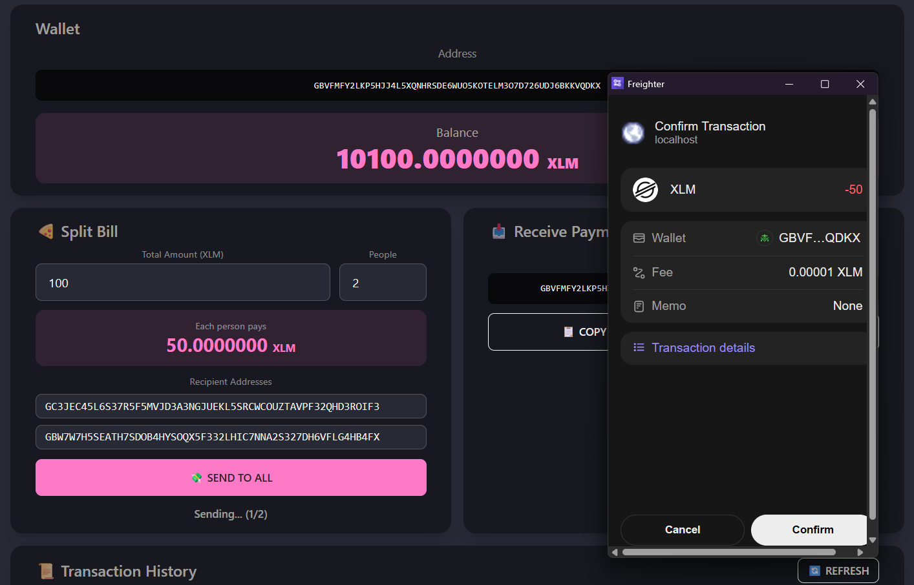
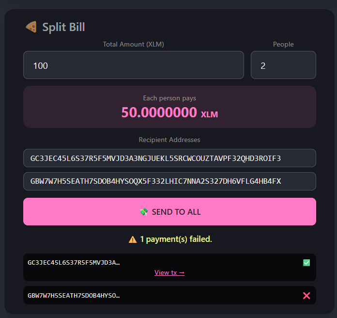
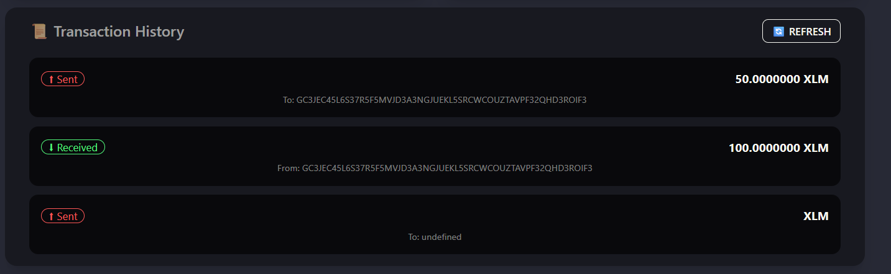

# 💸 PayShare dApp

This is a Level 1 project for **Stellar Journey to Mastery: Monthly Builder Challenges**.
I built it to learn Stellar — how wallets work, how to send XLM, and how to read the blockchain.

The app lets you enter a total bill, split it between friends, and send XLM to each person's address.

---

## Setup

Install [Freighter wallet](https://www.freighter.app/) and set it to **Testnet**. Fund your wallet from inside the extension.

Then run:

```bash
npm install
npm start
```

App opens at `https://localhost:3000`

---

## How to use

1. Click **Connect Wallet**
2. Enter the total amount and number of people
3. Enter each person's Stellar address
4. Click **Send to All** — Freighter will ask you to confirm each payment

---

## Screenshots

**1. Wallet connected — address and XLM balance is shown**


**2. QR code — share it so others can send you XLM**


**3. Freighter popup — it shows the amount and asks you to confirm**


**4. Split bill result — green means sent, red means failed. Each one has an explorer link**


**5. Transaction history — shows sent and received payments**


---

## Stack

React · Stellar SDK · Freighter API · Tailwind CSS · DaisyUI
